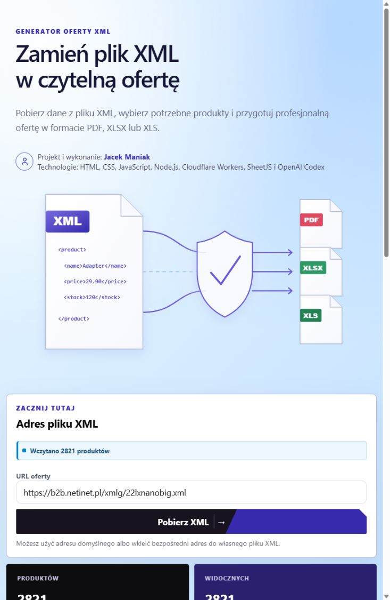

# Generator XML → PDF / XLSX / XLS


Publiczna wersja demonstracyjna aplikacji do użytku wewnętrznego, która pobiera ofertę produktową z pliku XML, pozwala wyszukiwać i filtrować produkty, a następnie przygotować ofertę w formacie PDF, XLSX lub XLS.

> **Zakres projektu:** aplikacja obsługuje obecnie wyłącznie pliki XML generowane przez firmę Netinet. Parser został przygotowany pod strukturę danych Netinet (`offers > o`), dlatego poprawna obsługa plików z innych systemów nie jest gwarantowana.

[Uruchom aplikację](https://generator-xml-oferta-training.admprocpu.workers.dev/) · [Zobacz wersję treningową na GitHubie](https://github.com/JacekManiakPolska/generator-xml-oferta/tree/codex/training-deployment)



## Najważniejsze funkcjonalności

- pobieranie domyślnego albo podanego przez użytkownika adresu pliku XML wygenerowanego przez Netinet,
- odczytywanie oferty Netinet w strukturze `offers > o`,
- inteligentne wyszukiwanie wielu fraz oddzielonych przecinkami,
- filtrowanie po kategoriach i znacznikach znajdujących się w XML,
- wybieranie produktów również poza aktualnie widocznym widokiem,
- eksport całej przefiltrowanej oferty lub zaznaczonych produktów do PDF, XLSX i XLS,
- opcjonalne dołączanie adresów zdjęć do arkusza,
- linki prowadzące do demonstracyjnego podglądu produktów Netinet.

## Jak działa aplikacja

1. Użytkownik podaje adres pliku XML wygenerowanego przez Netinet albo korzysta z danych demonstracyjnych.
2. Backend pobiera plik, sprawdza adres i limit rozmiaru, a przeglądarka odczytuje produkty.
3. Użytkownik wyszukuje, filtruje i zaznacza potrzebne pozycje.
4. Gotową ofertę można wyeksportować do arkusza albo zapisać jako PDF.

Przepływ danych:

`adres pliku → bezpieczne pobranie XML → odczytanie produktów → filtrowanie → eksport`

## Technologie

- HTML i CSS,
- JavaScript w modułach ESM,
- Node.js,
- Cloudflare Workers i Static Assets,
- SheetJS do generowania XLSX i XLS,
- natywny mechanizm wydruku przeglądarki do przygotowania PDF,
- Node Test Runner do testów automatycznych,
- OpenAI Codex jako narzędzie wspierające analizę, implementację i audyt.

## Bezpieczeństwo i testy

Projekt zawiera między innymi:

- blokadę jawnych adresów lokalnych i prywatnych przy pobieraniu XML,
- limit rzeczywiście przesłanych danych XML wynoszący 50 MiB,
- timeout pobierania danych,
- wymuszenie bezpiecznych nagłówków odpowiedzi XML,
- izolację podglądu HTML za pomocą Content Security Policy i sandboxu,
- listę dozwolonego źródła zdjęć,
- lokalny serwer dostępny wyłącznie przez `127.0.0.1`,
- testy przypadków brzegowych dotyczących wdrożenia, eksportu, wyszukiwania, zaznaczania produktów i zabezpieczeń.

Uruchomienie wszystkich testów:

```powershell
npm.cmd test
```

## Uruchomienie lokalne

Wymagany jest Node.js 20 lub nowszy.

```powershell
npm.cmd start
```

Następnie otwórz:

```text
http://localhost:3000
```

Domyślny feed demonstracyjny:

```text
https://b2b.netinet.pl/xmlg/22lxnanobig.xml
```

## Konfiguracja środowiska Cloudflare

Plik `.dev.vars.example` pokazuje nazwy zmiennych potrzebnych podczas lokalnego uruchamiania Workera. Nie zawiera prawdziwych sekretów.

```powershell
Copy-Item .dev.vars.example .dev.vars
npx.cmd wrangler dev --config wrangler.training.jsonc
```

Plik `.dev.vars` jest ignorowany przez Git i nie powinien być wysyłany do repozytorium. Sekrety wersji produkcyjnej należy ustawiać w panelu Cloudflare lub poleceniem `wrangler secret put`.

## Struktura projektu

- `server.mjs` – lokalny serwer Node.js i bezpieczne pobieranie XML,
- `src/worker.js` – obsługa aplikacji uruchomionej w Cloudflare,
- `public/app.js` – interfejs, analiza produktów, filtry i eksport,
- `public/product-search.js` – wyszukiwanie produktów,
- `public/selection-view.js` – obsługa zaznaczonych produktów,
- `public/print-offer.js` – generowanie widoku PDF,
- `public/image-url.js` – sprawdzanie adresów zdjęć,
- `test/` – automatyczne testy projektu,
- `wrangler.training.jsonc` – konfiguracja wdrożenia treningowego.

## Kontekst szkoleniowy: zadanie dekompozycyjne

Jednym z ćwiczeń realizowanych na bazie projektu było zaplanowanie wydzielenia parsera XML z `public/app.js` do małego, niezależnego modułu.

Założenia zadania:

- moduł przyjmuje tekst XML,
- zwraca listę produktów,
- zachowuje obecne pola produktów i komunikaty błędów,
- nie pobiera danych z internetu,
- nie zmienia wyglądu strony, filtrowania, eksportu ani zabezpieczeń sieciowych,
- posiada osobne testy automatyczne.

Ćwiczenie pokazuje podział większej funkcjonalności na mniejsze zadania oraz pracę z ograniczonym, uporządkowanym kontekstem.

## Wdrożenie

Wersja treningowa jest automatycznie budowana i wdrażana na Cloudflare po wysłaniu zmian do gałęzi `codex/training-deployment`.

Publiczny adres aplikacji:

https://generator-xml-oferta-training.admprocpu.workers.dev/

## Autor

Projekt i wykonanie: **Jacek Maniak**
